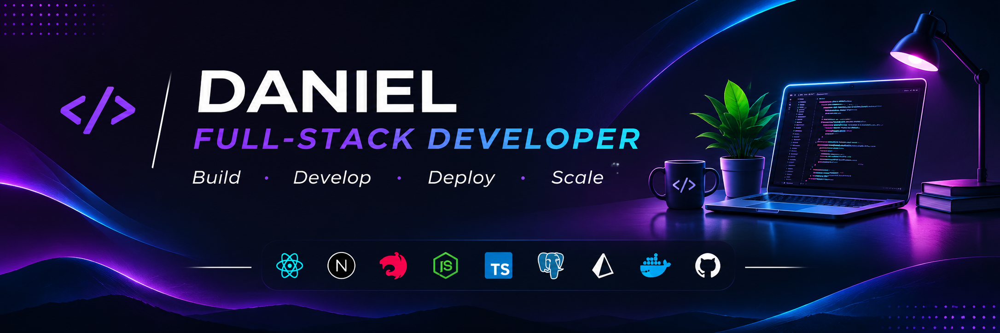
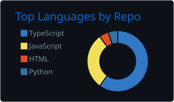
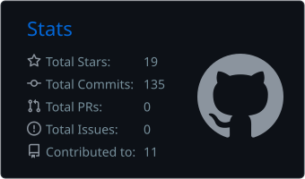

  

# Hey there, I'm Daniel 👋

### Full-Stack Developer | Building Scalable Web Applications & Digital Products

I'm a Full-Stack Developer passionate about designing and building modern web applications, scalable backend systems, and reliable digital products.

I enjoy turning ideas into practical solutions — combining clean frontend experiences, robust backend architectures, and well-structured databases to solve real-world problems.

- 🚀 Currently building **ERMP**, an enterprise pharmacy management platform.
- 💻 Interested in scalable architectures, backend engineering, and modern web technologies.
- 🌱 Always learning, experimenting, and improving my engineering skills.
- 🤝 Open to collaboration, freelance opportunities, and exciting projects.

---

## 🛠️ Technology Stack

### Frontend Development

  

### Backend Development

  

### Database & ORM

  

### Tools & Platforms

  

---

## 🚀 Featured Project

### 🏥 ERMP — Enterprise Retail Management Platform

**A privately developed enterprise platform for modern pharmacy operations.**

ERMP is a multi-tenant pharmacy management solution designed to streamline business operations, inventory control, procurement, and access management across multiple branches.

**Key capabilities:**

- 🔐 Dynamic User Management & Role-Based Access Control
- 🏢 Multi-Tenant & Multi-Branch Management
- 📦 Inventory & Stock Management
- 🛒 Point of Sale & Checkout
- 📋 Procurement & Supplier Management
- 📊 Reporting, Analytics & Dashboards

**Technology:** Next.js · NestJS · TypeScript · PostgreSQL · Prisma · Docker

🔒 Repository: Private — Proprietary Project

---

## 📊 GitHub Analytics

  

  
  

  
  

---

## 🌐 Let's Connect

  
  
  

---

  <i>"Great software isn't just written. It's thoughtfully engineered."</i>

  ⭐ Thanks for visiting my profile. Feel free to explore my work and connect!

